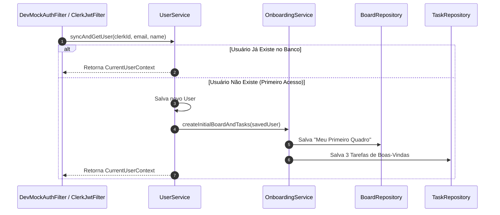

# Notas de Design e Especificação Técnica - Ticket 03
## Gerenciamento de Quadros (Boards) e Onboarding Automático

**Referência do Ticket:** `.scratch/kanban/issues/03-boards-crud-and-onboarding.md`  
**Documentos Base:** `SPEC.md` (Seções 3 e 4.1), `DESIGN.md` (Seção 1 e Seção 4.2), `GLOSSARY.md` (Board, Onboarding, Soft Delete)  
**Dependência:** Ticket 02 (`.scratch/kanban/issues/02-security-dev-mock-and-user-jit.md`)

---

## 1. Visão Geral e Responsabilidades do Domínio

O Ticket 03 introduz o contêiner de alto nível do sistema: o **Board** (Quadro Kanban).
Cada Board pertence estritamente a um **User** autenticado. O sistema deve garantir:
1. **Isolamento de Dados (Tenant Isolation):** Usuários só podem visualizar, editar e excluir seus próprios quadros.
2. **Soft Delete:** A exclusão de um quadro não remove fisicamente a tupla do banco de dados; ela preenche o campo `deleted_at`, ocultando-o de todas as consultas ativas da API.
3. **Onboarding Automático:** Quando um usuário é autenticado pela primeira vez (JIT Sync), o sistema cria automaticamente `"Meu Primeiro Quadro"` acompanhado de 3 tarefas iniciais para introdução à metodologia Kanban.

---

## 2. Entidade de Domínio `Board`

### 2.1. Estrutura do Modelo de Dados
A entidade `Board` é mapeada na tabela `boards` e possui relacionamento com `users`:

| Coluna | Tipo SQL | Restrições | Descrição |
|---|---|---|---|
| `id` | `BIGINT` | `PK, AUTO_INCREMENT` | Identificador único do quadro |
| `user_id` | `BIGINT` | `FK, NOT NULL` | Chave estrangeira para o dono (`users.id`) |
| `name` | `VARCHAR(150)` | `NOT NULL` | Nome do quadro (ex: "Estudos DIO") |
| `description` | `VARCHAR(1000)` | `NULLABLE` | Descrição opcional dos objetivos do quadro |
| `created_at` | `TIMESTAMP` | `NOT NULL, UPDATABLE=FALSE` | Data/hora de criação gerenciada via `@PrePersist` |
| `updated_at` | `TIMESTAMP` | `NULLABLE` | Data/hora da última alteração gerenciada via `@PreUpdate` |
| `deleted_at` | `TIMESTAMP` | `NULLABLE` | Timestamp do Soft Delete (`NULL` para quadros ativos) |

### 2.2. Código de Referência da Entidade JPA (`com.amelosbc.taskmanager.domain.Board`)

```java
package com.amelosbc.taskmanager.domain;

import jakarta.persistence.*;
import jakarta.validation.constraints.NotBlank;
import jakarta.validation.constraints.Size;
import java.time.LocalDateTime;

@Entity
@Table(name = "boards")
public class Board {

    @Id
    @GeneratedValue(strategy = GenerationType.IDENTITY)
    private Long id;

    @ManyToOne(fetch = FetchType.LAZY, optional = false)
    @JoinColumn(name = "user_id", nullable = false)
    private User user;

    @NotBlank(message = "O nome do quadro é obrigatório")
    @Size(max = 150, message = "O nome do quadro deve ter no máximo 150 caracteres")
    @Column(name = "name", nullable = false, length = 150)
    private String name;

    @Size(max = 1000, message = "A descrição deve ter no máximo 1000 caracteres")
    @Column(name = "description", length = 1000)
    private String description;

    @Column(name = "created_at", nullable = false, updatable = false)
    private LocalDateTime createdAt;

    @Column(name = "updated_at")
    private LocalDateTime updatedAt;

    @Column(name = "deleted_at")
    private LocalDateTime deletedAt;

    public Board() {
    }

    public Board(User user, String name, String description) {
        this.user = user;
        this.name = name;
        this.description = description;
    }

    @PrePersist
    protected void onCreate() {
        this.createdAt = LocalDateTime.now();
        this.updatedAt = LocalDateTime.now();
    }

    @PreUpdate
    protected void onUpdate() {
        this.updatedAt = LocalDateTime.now();
    }

    // Helper methods para Soft Delete
    public boolean isDeleted() {
        return this.deletedAt != null;
    }

    public void markDeleted() {
        this.deletedAt = LocalDateTime.now();
        this.updatedAt = LocalDateTime.now();
    }

    // Getters e Setters
    public Long getId() { return id; }
    public void setId(Long id) { this.id = id; }

    public User getUser() { return user; }
    public void setUser(User user) { this.user = user; }

    public String getName() { return name; }
    public void setName(String name) { this.name = name; }

    public String getDescription() { return description; }
    public void setDescription(String description) { this.description = description; }

    public LocalDateTime getCreatedAt() { return createdAt; }
    public void setCreatedAt(LocalDateTime createdAt) { this.createdAt = createdAt; }

    public LocalDateTime getUpdatedAt() { return updatedAt; }
    public void setUpdatedAt(LocalDateTime updatedAt) { this.updatedAt = updatedAt; }

    public LocalDateTime getDeletedAt() { return deletedAt; }
    public void setDeletedAt(LocalDateTime deletedAt) { this.deletedAt = deletedAt; }
}
```

---

## 3. Repositório `BoardRepository` e Estratégia de Soft Delete

### 3.1. Estratégia de Filtragem de Soft Delete
Conforme definido na Seção 4.2 do `DESIGN.md` e no `GLOSSARY.md`, todo registro cujo `deleted_at` não for nulo é considerado inativo e deve ser excluído das operações normais de leitura da API.

Ao invés de depender de anotações mágicas do Hibernate que afetam queries globais sem flexibilidade, adota-se o padrão explícito do Spring Data JPA com queries de convenção `...AndDeletedAtIsNull`:

```java
package com.amelosbc.taskmanager.domain;

import org.springframework.data.jpa.repository.JpaRepository;
import org.springframework.stereotype.Repository;

import java.util.List;
import java.util.Optional;

@Repository
public interface BoardRepository extends JpaRepository<Board, Long> {

    /**
     * Retorna todos os quadros ativos de um usuário específico.
     */
    List<Board> findAllByUserIdAndDeletedAtIsNull(Long userId);

    /**
     * Busca um quadro ativo por ID e usuário (garante tenant isolation).
     */
    Optional<Board> findByIdAndUserIdAndDeletedAtIsNull(Long id, Long userId);

    /**
     * Verifica se existe um quadro ativo pertencente a um usuário.
     */
    boolean existsByIdAndUserIdAndDeletedAtIsNull(Long id, Long userId);

    /**
     * Busca um quadro ativo apenas pelo ID (uso administrativo ou verificação prévia).
     */
    Optional<Board> findByIdAndDeletedAtIsNull(Long id);
}
```

### 3.2. Mecanismo de Exclusão no `BoardService`
O método de exclusão no serviço nunca invoca `boardRepository.delete(board)` diretamente. Ele executa:

```java
@Transactional
public void deleteBoard(Long boardId, Long userId) {
    Board board = boardRepository.findByIdAndUserIdAndDeletedAtIsNull(boardId, userId)
        .orElseThrow(() -> new ResourceNotFoundException("Quadro não encontrado com o id: " + boardId));

    board.markDeleted();
    boardRepository.save(board);
    // Nota: O Ticket 06 ou a cascata aplicará soft delete recursivo nas tarefas filhas.
}
```

> **Regra de Segurança de Isolamento:** Se o usuário B tentar acessar ou deletar o quadro pertencente ao usuário A, o `findByIdAndUserIdAndDeletedAtIsNull` não encontrará o registro e lançará `ResourceNotFoundException` (HTTP 404). Isso evita o vazamento de existência do recurso (anti enumeration attack).

---

## 4. Contratos de DTO (Data Transfer Objects)

Os DTOs são modelados como Java Records imutáveis, pertencentes à camada `com.amelosbc.taskmanager.application.dto`.

### 4.1. `BoardRequestDTO` (Payload de Criação e Atualização)
```java
package com.amelosbc.taskmanager.application.dto;

import io.swagger.v3.oas.annotations.media.Schema;
import jakarta.validation.constraints.NotBlank;
import jakarta.validation.constraints.Size;

@Schema(description = "Dados para criação ou atualização de um Quadro Kanban")
public record BoardRequestDTO(

    @Schema(description = "Nome do quadro", example = "Estudos DIO - Backend Java")
    @NotBlank(message = "O nome do quadro é obrigatório")
    @Size(max = 150, message = "O nome do quadro deve ter no máximo 150 caracteres")
    String name,

    @Schema(description = "Descrição detalhada do propósito do quadro", example = "Quadro de acompanhamento do bootcamp DIO")
    @Size(max = 1000, message = "A descrição deve ter no máximo 1000 caracteres")
    String description
) {}
```

### 4.2. `BoardResponseDTO` (Retorno de Quadro)
```java
package com.amelosbc.taskmanager.application.dto;

import com.amelosbc.taskmanager.domain.Board;
import io.swagger.v3.oas.annotations.media.Schema;
import java.time.LocalDateTime;

@Schema(description = "Representação detalhada de um Quadro Kanban")
public record BoardResponseDTO(
    @Schema(description = "ID único do quadro", example = "1")
    Long id,

    @Schema(description = "Nome do quadro", example = "Estudos DIO")
    String name,

    @Schema(description = "Descrição do quadro", example = "Acompanhamento das tarefas")
    String description,

    @Schema(description = "Data de criação")
    LocalDateTime createdAt,

    @Schema(description = "Data da última atualização")
    LocalDateTime updatedAt
) {
    public static BoardResponseDTO fromDomain(Board board) {
        return new BoardResponseDTO(
            board.getId(),
            board.getName(),
            board.getDescription(),
            board.getCreatedAt(),
            board.getUpdatedAt()
        );
    }
}
```

---

## 5. Regra e Arquitetura de Onboarding Automático

### 5.1. Onde e Como Interceptar
Conforme especificado em `DESIGN.md` (Seção 3 - Diagrama de Sequência) e `SPEC.md` (Seção 2):
- O momento exato da criação do onboarding é durante a **sincronização JIT de Usuário** (`UserService.syncAndGetUser`), ou seja, quando um novo usuário se autentica pela primeira vez (seja via token JWT Clerk ou via header `X-Mock-User`).
- Para desacoplamento e respeito ao Princípio da Responsabilidade Única (SRP), a lógica de criação do quadro inicial e das 3 tarefas é delegada a um componente de aplicação: `OnboardingService`.



### 5.2. Especificação das Tarefas de Boas-Vindas
O onboarding cria o quadro `"Meu Primeiro Quadro"` e popula exatamente 3 tarefas:

1. **Tarefa 1:**
   - **Título:** `"Bem-vindo ao seu Kanban!"`
   - **Descrição:** `"Este é o seu primeiro cartão. Aqui você pode gerenciar suas atividades, metas de estudo e rotina diária."`
   - **Status:** `TaskStatus.TO_DO`
   - **Prioridade:** `TaskPriority.MEDIUM`
   - **Posição:** `0`

2. **Tarefa 2:**
   - **Título:** `"Arraste os cartões entre as colunas"`
   - **Descrição:** `"Experimente mover as tarefas entre as etapas do fluxo de trabalho: A Fazer, Em Progresso, Em Revisão e Concluído."`
   - **Status:** `TaskStatus.IN_PROGRESS`
   - **Prioridade:** `TaskPriority.HIGH`
   - **Posição:** `0`

3. **Tarefa 3:**
   - **Título:** `"Conclua suas metas dos estudos DIO!"`
   - **Descrição:** `"Ao finalizar um módulo ou projeto prático, arraste o cartão até a coluna de Concluído para acompanhar seu progresso."`
   - **Status:** `TaskStatus.DONE`
   - **Prioridade:** `TaskPriority.URGENT`
   - **Posição:** `0`

### 5.3. Implementação do `OnboardingService`
```java
package com.amelosbc.taskmanager.application;

import com.amelosbc.taskmanager.domain.*;
import org.springframework.stereotype.Service;
import org.springframework.transaction.annotation.Transactional;

import java.util.List;

@Service
public class OnboardingService {

    public static final String INITIAL_BOARD_NAME = "Meu Primeiro Quadro";
    public static final String INITIAL_BOARD_DESC = "Quadro de boas-vindas criado automaticamente para você começar.";

    private final BoardRepository boardRepository;
    private final TaskRepository taskRepository;

    public OnboardingService(BoardRepository boardRepository, TaskRepository taskRepository) {
        this.boardRepository = boardRepository;
        this.taskRepository = taskRepository;
    }

    @Transactional
    public Board createInitialBoardForUser(User user) {
        Board initialBoard = new Board(user, INITIAL_BOARD_NAME, INITIAL_BOARD_DESC);
        Board savedBoard = boardRepository.save(initialBoard);

        // Criar as 3 tarefas de boas-vindas
        Task task1 = new Task(
            savedBoard,
            "Bem-vindo ao seu Kanban!",
            "Este é o seu primeiro cartão. Aqui você pode gerenciar suas atividades, metas de estudo e rotina diária.",
            TaskStatus.TO_DO,
            TaskPriority.MEDIUM,
            0
        );

        Task task2 = new Task(
            savedBoard,
            "Arraste os cartões entre as colunas",
            "Experimente mover as tarefas entre as etapas do fluxo de trabalho: A Fazer, Em Progresso, Em Revisão e Concluído.",
            TaskStatus.IN_PROGRESS,
            TaskPriority.HIGH,
            0
        );

        Task task3 = new Task(
            savedBoard,
            "Conclua suas metas dos estudos DIO!",
            "Ao finalizar um módulo ou projeto prático, arraste o cartão até a coluna de Concluído para acompanhar seu progresso.",
            TaskStatus.DONE,
            TaskPriority.URGENT,
            0
        );

        taskRepository.saveAll(List.of(task1, task2, task3));
        return savedBoard;
    }
}
```

---

## 6. Endpoints do `BoardController` e OpenAPI

O controller deve ser registrado em `/api/boards` com proteção de autenticação e documentação Swagger completa:

```java
package com.amelosbc.taskmanager.infrastructure;

import com.amelosbc.taskmanager.application.BoardService;
import com.amelosbc.taskmanager.application.dto.BoardRequestDTO;
import com.amelosbc.taskmanager.application.dto.BoardResponseDTO;
import com.amelosbc.taskmanager.application.dto.CurrentUserContext;
import io.swagger.v3.oas.annotations.Operation;
import io.swagger.v3.oas.annotations.responses.ApiResponse;
import io.swagger.v3.oas.annotations.responses.ApiResponses;
import io.swagger.v3.oas.annotations.tags.Tag;
import jakarta.validation.Valid;
import org.springframework.http.HttpStatus;
import org.springframework.http.ResponseEntity;
import org.springframework.security.core.annotation.AuthenticationPrincipal;
import org.springframework.web.bind.annotation.*;

import java.util.List;

@RestController
@RequestMapping("/api/boards")
@Tag(name = "Boards", description = "Endpoints para gerenciamento de quadros Kanban do usuário")
public class BoardController {

    private final BoardService boardService;

    public BoardController(BoardService boardService) {
        this.boardService = boardService;
    }

    @Operation(summary = "Listar quadros ativos do usuário autenticado")
    @ApiResponses({
        @ApiResponse(responseCode = "200", description = "Lista de quadros retornada com sucesso"),
        @ApiResponse(responseCode = "401", description = "Não autenticado")
    })
    @GetMapping
    public ResponseEntity<List<BoardResponseDTO>> listBoards(
            @AuthenticationPrincipal CurrentUserContext currentUser
    ) {
        return ResponseEntity.ok(boardService.listBoards(currentUser.userId()));
    }

    @Operation(summary = "Obter detalhes de um quadro ativo")
    @ApiResponses({
        @ApiResponse(responseCode = "200", description = "Quadro encontrado"),
        @ApiResponse(responseCode = "404", description = "Quadro não encontrado ou não pertence ao usuário"),
        @ApiResponse(responseCode = "401", description = "Não autenticado")
    })
    @GetMapping("/{id}")
    public ResponseEntity<BoardResponseDTO> getBoardById(
            @PathVariable Long id,
            @AuthenticationPrincipal CurrentUserContext currentUser
    ) {
        return ResponseEntity.ok(boardService.getBoardById(id, currentUser.userId()));
    }

    @Operation(summary = "Criar novo quadro Kanban")
    @ApiResponses({
        @ApiResponse(responseCode = "201", description = "Quadro criado com sucesso"),
        @ApiResponse(responseCode = "400", description = "Dados inválidos fornecidos no payload"),
        @ApiResponse(responseCode = "401", description = "Não autenticado")
    })
    @PostMapping
    public ResponseEntity<BoardResponseDTO> createBoard(
            @Valid @RequestBody BoardRequestDTO request,
            @AuthenticationPrincipal CurrentUserContext currentUser
    ) {
        BoardResponseDTO created = boardService.createBoard(request, currentUser.userId());
        return ResponseEntity.status(HttpStatus.CREATED).body(created);
    }

    @Operation(summary = "Atualizar metadados de um quadro")
    @ApiResponses({
        @ApiResponse(responseCode = "200", description = "Quadro atualizado com sucesso"),
        @ApiResponse(responseCode = "400", description = "Dados inválidos"),
        @ApiResponse(responseCode = "404", description = "Quadro não encontrado"),
        @ApiResponse(responseCode = "401", description = "Não autenticado")
    })
    @PutMapping("/{id}")
    public ResponseEntity<BoardResponseDTO> updateBoard(
            @PathVariable Long id,
            @Valid @RequestBody BoardRequestDTO request,
            @AuthenticationPrincipal CurrentUserContext currentUser
    ) {
        return ResponseEntity.ok(boardService.updateBoard(id, request, currentUser.userId()));
    }

    @Operation(summary = "Excluir quadro (Soft Delete)")
    @ApiResponses({
        @ApiResponse(responseCode = "204", description = "Quadro excluído com sucesso"),
        @ApiResponse(responseCode = "404", description = "Quadro não encontrado"),
        @ApiResponse(responseCode = "401", description = "Não autenticado")
    })
    @DeleteMapping("/{id}")
    public ResponseEntity<Void> deleteBoard(
            @PathVariable Long id,
            @AuthenticationPrincipal CurrentUserContext currentUser
    ) {
        boardService.deleteBoard(id, currentUser.userId());
        return ResponseEntity.noContent().build();
    }
}
```

---

## 7. Especificação de Testes MockMvc (`BoardControllerTest`)

Os testes devem validar os fluxos funcionais, segurança multi-usuário e a semântica do Soft Delete.

### 7.1. Cenários de Teste Essenciais

#### Cenário 1: Listagem de Quadros do Usuário Autenticado
- **Objetivo:** Garantir que `GET /api/boards` retorna apenas os quadros ativos associados ao `userId` autenticado.
- **Entrada:** Requisição com header `X-Mock-User: user-1`.
- **Validações:**
  - Status HTTP `200 OK`.
  - Content-Type `application/json`.
  - JSON Array contendo apenas os quadros do `user-1`.
  - Propriedades `id`, `name` e `description` presentes.

#### Cenário 2: Isolamento entre Usuários (Multi-tenant Isolation)
- **Objetivo:** Garantir que o Usuário B não consiga ler, alterar nem deletar recursos do Usuário A.
- **Caso A (Leitura):** Usuário B (`X-Mock-User: user-2`) tenta `GET /api/boards/{id_quadro_do_user_1}`.
  - **Expectativa:** Status `404 Not Found` (não deve vazar existência nem permitir visualização).
- **Caso B (Edição):** Usuário B (`X-Mock-User: user-2`) tenta `PUT /api/boards/{id_quadro_do_user_1}` com novo nome.
  - **Expectativa:** Status `404 Not Found`. O quadro no banco permanece inalterado.
- **Caso C (Exclusão):** Usuário B (`X-Mock-User: user-2`) tenta `DELETE /api/boards/{id_quadro_do_user_1}`.
  - **Expectativa:** Status `404 Not Found`. O quadro do Usuário A permanece ativo (`deleted_at IS NULL`).

#### Cenário 3: Exclusão com Soft Delete
- **Objetivo:** Verificar se a exclusão via API preserva o registro no banco com `deleted_at` preenchido.
- **Passos:**
  1. Usuário A autenticado executa `DELETE /api/boards/{id}`.
  2. A API responde com `204 No Content`.
  3. Nova chamada `GET /api/boards/{id}` pelo mesmo Usuário A responde com `404 Not Found`.
  4. Nova chamada `GET /api/boards` pelo Usuário A não lista mais o quadro deletado.
  5. Consulta direta ao `boardRepository.findById(id)` confirma que a entidade **ainda existe no banco**, mas com `deletedAt != null`.

#### Cenário 4: Validação de Payload na Criação (Bean Validation)
- **Objetivo:** Rejeitar requisições inválidas de criação.
- **Payload:** `POST /api/boards` com `{"name": "", "description": "Desc"}`.
- **Expectativa:** HTTP `400 Bad Request` com mensagem de validação contendo `"O nome do quadro é obrigatório"`.

#### Cenário 5: Onboarding no Primeiro Acesso
- **Objetivo:** Validar que um usuário novo que envia uma requisição recebe automaticamente `"Meu Primeiro Quadro"` e 3 tarefas de boas-vindas.
- **Passos:**
  1. Enviar requisição `GET /api/boards` com `X-Mock-User: new-user-onboarding-test`.
  2. O filtro mock/JIT sync detecta que o usuário é novo, dispara o `OnboardingService`.
  3. A resposta HTTP `200 OK` retorna uma lista contendo exatamente 1 quadro com nome `"Meu Primeiro Quadro"`.
  4. Consulta direta ao banco de tarefas valida a existência das 3 tarefas com os títulos:
     - `"Bem-vindo ao seu Kanban!"`
     - `"Arraste os cartões entre as colunas"`
     - `"Conclua suas metas dos estudos DIO!"`

### 7.2. Código de Referência para os Testes MockMvc

```java
package com.amelosbc.taskmanager.infrastructure;

import com.amelosbc.taskmanager.application.dto.BoardRequestDTO;
import com.amelosbc.taskmanager.domain.*;
import com.fasterxml.jackson.databind.ObjectMapper;
import org.junit.jupiter.api.BeforeEach;
import org.junit.jupiter.api.DisplayName;
import org.junit.jupiter.api.Test;
import org.springframework.beans.factory.annotation.Autowired;
import org.springframework.boot.test.autoconfigure.web.servlet.AutoConfigureMockMvc;
import org.springframework.boot.test.context.SpringBootTest;
import org.springframework.http.MediaType;
import org.springframework.test.context.ActiveProfiles;
import org.springframework.test.web.servlet.MockMvc;

import static org.hamcrest.Matchers.*;
import static org.junit.jupiter.api.Assertions.*;
import static org.springframework.test.web.servlet.request.MockMvcRequestBuilders.*;
import static org.springframework.test.web.servlet.result.MockMvcResultMatchers.*;

@SpringBootTest
@AutoConfigureMockMvc
@ActiveProfiles("test")
public class BoardControllerTest {

    @Autowired
    private MockMvc mockMvc;

    @Autowired
    private ObjectMapper objectMapper;

    @Autowired
    private UserRepository userRepository;

    @Autowired
    private BoardRepository boardRepository;

    @Autowired
    private TaskRepository taskRepository;

    private User userA;
    private User userB;
    private Board boardA;

    @BeforeEach
    void setUp() {
        taskRepository.deleteAll();
        boardRepository.deleteAll();
        userRepository.deleteAll();

        userA = userRepository.save(new User("clerk-user-a", "usera@dio.me", "User A"));
        userB = userRepository.save(new User("clerk-user-b", "userb@dio.me", "User B"));

        boardA = boardRepository.save(new Board(userA, "Quadro User A", "Descrição Quadro A"));
    }

    @Test
    @DisplayName("GET /api/boards deve retornar apenas os quadros ativos do usuário autenticado")
    void shouldListOnlyAuthenticatedUserBoards() throws Exception {
        // Cria um quadro para userB
        boardRepository.save(new Board(userB, "Quadro User B", "Descrição Quadro B"));

        mockMvc.perform(get("/api/boards")
                .header("X-Mock-User", "clerk-user-a"))
                .andExpect(status().isOk())
                .andExpect(jsonPath("$", hasSize(1)))
                .andExpect(jsonPath("$[0].name", is("Quadro User A")));
    }

    @Test
    @DisplayName("Isolamento: Usuário B não pode acessar o quadro do Usuário A (deve retornar 404)")
    void shouldReturn404WhenUserBAccessesUserABoard() throws Exception {
        mockMvc.perform(get("/api/boards/" + boardA.getId())
                .header("X-Mock-User", "clerk-user-b"))
                .andExpect(status().isNotFound());
    }

    @Test
    @DisplayName("Isolamento: Usuário B não pode alterar o quadro do Usuário A (deve retornar 404)")
    void shouldReturn404WhenUserBUpdatesUserABoard() throws Exception {
        BoardRequestDTO updatePayload = new BoardRequestDTO("Tentativa Hack", "Invasao");

        mockMvc.perform(put("/api/boards/" + boardA.getId())
                .header("X-Mock-User", "clerk-user-b")
                .contentType(MediaType.APPLICATION_JSON)
                .content(objectMapper.writeValueAsString(updatePayload)))
                .andExpect(status().isNotFound());

        // Confirma que não houve alteração no banco
        Board original = boardRepository.findById(boardA.getId()).orElseThrow();
        assertEquals("Quadro User A", original.getName());
    }

    @Test
    @DisplayName("Isolamento: Usuário B não pode deletar o quadro do Usuário A (deve retornar 404)")
    void shouldReturn404WhenUserBDeletesUserABoard() throws Exception {
        mockMvc.perform(delete("/api/boards/" + boardA.getId())
                .header("X-Mock-User", "clerk-user-b"))
                .andExpect(status().isNotFound());

        Board original = boardRepository.findById(boardA.getId()).orElseThrow();
        assertNull(original.getDeletedAt());
    }

    @Test
    @DisplayName("DELETE /api/boards/{id} deve realizar Soft Delete e sumir da listagem ativa")
    void shouldPerformSoftDeleteSuccessfully() throws Exception {
        mockMvc.perform(delete("/api/boards/" + boardA.getId())
                .header("X-Mock-User", "clerk-user-a"))
                .andExpect(status().isNoContent());

        // Chamada direta pelo ID agora retorna 404
        mockMvc.perform(get("/api/boards/" + boardA.getId())
                .header("X-Mock-User", "clerk-user-a"))
                .andExpect(status().isNotFound());

        // Listagem agora retorna vazio
        mockMvc.perform(get("/api/boards")
                .header("X-Mock-User", "clerk-user-a"))
                .andExpect(status().isOk())
                .andExpect(jsonPath("$", hasSize(0)));

        // Registro ainda existe fisicamente no banco com deleted_at preenchido
        Board deletedEntity = boardRepository.findById(boardA.getId()).orElseThrow();
        assertNotNull(deletedEntity.getDeletedAt());
    }

    @Test
    @DisplayName("POST /api/boards com dados válidos deve criar e retornar 201 Created")
    void shouldCreateBoardSuccessfully() throws Exception {
        BoardRequestDTO request = new BoardRequestDTO("Novo Quadro Estudos", "Rotina Semanal");

        mockMvc.perform(post("/api/boards")
                .header("X-Mock-User", "clerk-user-a")
                .contentType(MediaType.APPLICATION_JSON)
                .content(objectMapper.writeValueAsString(request)))
                .andExpect(status().isCreated())
                .andExpect(jsonPath("$.id", notNullValue()))
                .andExpect(jsonPath("$.name", is("Novo Quadro Estudos")))
                .andExpect(jsonPath("$.description", is("Rotina Semanal")));
    }

    @Test
    @DisplayName("POST /api/boards com nome vazio deve retornar 400 Bad Request")
    void shouldRejectEmptyBoardName() throws Exception {
        BoardRequestDTO request = new BoardRequestDTO("", "Sem nome");

        mockMvc.perform(post("/api/boards")
                .header("X-Mock-User", "clerk-user-a")
                .contentType(MediaType.APPLICATION_JSON)
                .content(objectMapper.writeValueAsString(request)))
                .andExpect(status().isBadRequest());
    }

    @Test
    @DisplayName("Onboarding: Primeiro acesso de usuário deve criar 'Meu Primeiro Quadro' com 3 tarefas")
    void shouldTriggerOnboardingForNewUser() throws Exception {
        String newClerkUser = "new-onboarding-user";

        mockMvc.perform(get("/api/boards")
                .header("X-Mock-User", newClerkUser))
                .andExpect(status().isOk())
                .andExpect(jsonPath("$", hasSize(1)))
                .andExpect(jsonPath("$[0].name", is("Meu Primeiro Quadro")));

        // Verifica as tarefas no banco criadas para o quadro de onboarding
        Board onboardingBoard = boardRepository.findAllByUserIdAndDeletedAtIsNull(
                userRepository.findByClerkUserId(newClerkUser).orElseThrow().getId()
        ).getFirst();

        var tasks = taskRepository.findAll(); // ou filtro por boardId quando associado
        assertTrue(tasks.stream().anyMatch(t -> t.getTitle().equals("Bem-vindo ao seu Kanban!")));
        assertTrue(tasks.stream().anyMatch(t -> t.getTitle().equals("Arraste os cartões entre as colunas")));
        assertTrue(tasks.stream().anyMatch(t -> t.getTitle().equals("Conclua suas metas dos estudos DIO!")));
    }
}
```

---

## 8. Check-list de Implementação para a Fase TDD (Ticket 03)

- [ ] Criar entidade `Board` em `domain/Board.java` com anotações JPA e validações de tamanho.
- [ ] Criar `BoardRepository` em `domain/BoardRepository.java` com métodos `...AndDeletedAtIsNull`.
- [ ] Ajustar `Task` para conter o relacionamento `@ManyToOne` com `Board` e campos de prioridade/status/posição (alinhado com Tickets 01 e 04).
- [ ] Criar `BoardRequestDTO` e `BoardResponseDTO` em `application/dto/`.
- [ ] Implementar `OnboardingService` em `application/OnboardingService.java` criando `"Meu Primeiro Quadro"` e as 3 tarefas obrigatórias.
- [ ] Conectar `OnboardingService` ao `UserService` no momento do registro do novo usuário.
- [ ] Implementar `BoardService` em `application/BoardService.java` garantindo tenant isolation e soft delete.
- [ ] Implementar `BoardController` em `infrastructure/BoardController.java` com OpenAPI annotations.
- [ ] Implementar suite de testes `BoardControllerTest` com cobertura completa dos cenários descritos.
