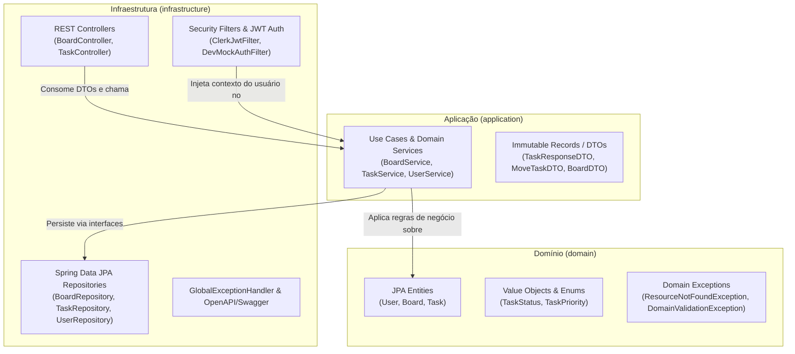
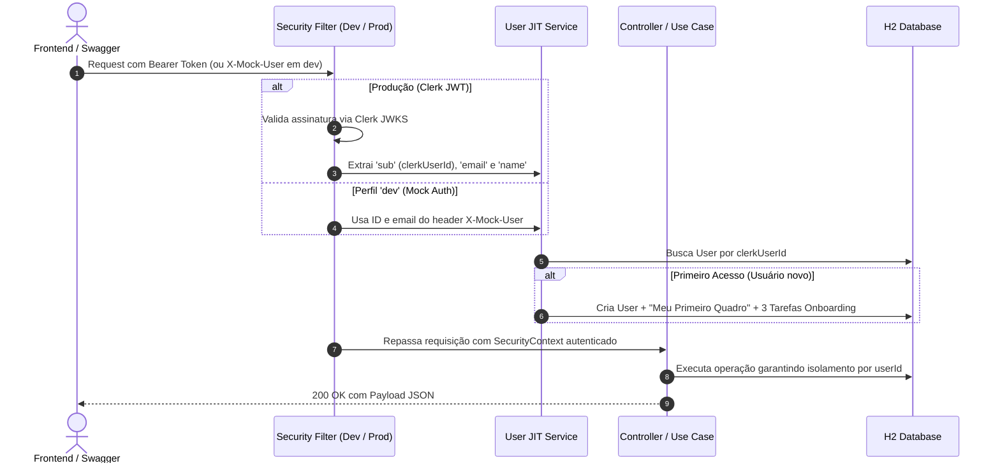

# DESIGN: TaskManager Architecture & Technical Blueprint

Este documento descreve as decisões arquiteturais, padrões de design, componentes tecnológicos e o fluxo de dados do backend do **TaskManager**.

---

## 1. Visão Geral da Arquitetura (Clean Architecture)

A aplicação segue a divisão estrita de responsabilidades em três camadas fundamentais:



### Regras de Dependência:
1. **Domínio:** Não depende de nenhuma camada externa (exceto anotações padrão JPA/Jakarta). É o coração das regras de negócio.
2. **Aplicação:** Orquestra os fluxos de trabalho (casos de uso) convertendo DTOs ↔ Entidades. Não conhece detalhes HTTP/REST.
3. **Infraestrutura:** Lida com frameworks externos (Spring MVC, Spring Security, Hibernate, H2, Swagger).

---

## 2. Pilha Tecnológica (Tech Stack)

| Tecnologia | Versão | Propósito |
|---|---|---|
| **Java** | 21 LTS | Registros (*records*), *pattern matching*, *sealed classes*, virtual threads. |
| **Spring Boot** | 3.4.1 | Framework base (Spring Web MVC, Spring Data JPA, Spring Validation). |
| **Spring Security** | 6.x | Proteção de endpoints, Resource Server e validação de tokens JWT. |
| **Clerk Auth** | SDK / JWKS | Gerenciamento de identidade, Magic Link e OTP no frontend. |
| **H2 Database** | 2.3.x | Banco de dados relacional embarcado persistido em arquivo (`./data/taskdb`). |
| **SpringDoc OpenAPI** | 2.7.0 | Especificação OpenAPI 3.0 e UI interativa Swagger. |
| **Maven** | 3.9.9 | Gerenciamento de dependências e ciclo de vida do build. |
| **JUnit 5 + Mockito** | Latest | Testes unitários e de integração com SpringBootTest e MockMvc. |

---

## 3. Segurança e Fluxo de Autenticação

A aplicação atua como um **OAuth2 Resource Server** sem estado (*stateless*):



---

## 4. Persistência e Estratégia de Dados

### 4.1. Configuração do H2 em Arquivo
O banco de dados não roda em memória volátil, mas grava em disco local:
```properties
spring.datasource.url=jdbc:h2:file:./data/taskdb;DB_CLOSE_DELAY=-1;DB_CLOSE_ON_EXIT=FALSE
spring.datasource.driverClassName=org.h2.Driver
spring.datasource.username=sa
spring.datasource.password=
spring.jpa.hibernate.ddl-auto=update
```

### 4.2. Soft Delete
Para manter histórico e permitir recuperação de dados:
* As entidades `Board` e `Task` possuem a coluna `deleted_at TIMESTAMP NULL`.
* Os repositórios executam consultas padrão filtrando `WHERE deleted_at IS NULL`.
* O método `delete()` faz um *update* preenchendo `deleted_at = LocalDateTime.now()`.

---

## 5. Algoritmo de Movimentação no Kanban (Dense Shift)

Ao movimentar uma tarefa para outra coluna ou reordenar:

```
Caso 1: Movendo da Coluna TO_DO para IN_PROGRESS na posição 0
Coluna Origem (TO_DO):
  - Tarefas com pos > posOrigem: pos = pos - 1 (fecha a lacuna)
Coluna Destino (IN_PROGRESS):
  - Tarefas com pos >= posDestino: pos = pos + 1 (abre espaço)
Tarefa Movida:
  - status = IN_PROGRESS, pos = 0
```
Toda a operação é executada de forma atômica sob a anotação `@Transactional`.

---

## 6. Estrutura de Pacotes do Projeto

```
src/main/java/com/amelosbc/taskmanager/
├── TaskmanagerApplication.java
├── domain/
│   ├── User.java
│   ├── Board.java
│   ├── Task.java
│   ├── TaskStatus.java
│   ├── TaskPriority.java
│   └── UserRepository.java / BoardRepository.java / TaskRepository.java
├── application/
│   ├── UserService.java
│   ├── BoardService.java
│   ├── TaskService.java
│   └── dto/
│       ├── BoardDTO.java
│       ├── TaskDTO.java
│       └── MoveTaskDTO.java
└── infrastructure/
    ├── config/ (OpenApiConfig, SecurityConfig)
    ├── security/ (ClerkJwtFilter, DevMockAuthFilter, CurrentUserContext)
    └── controllers/ (BoardController, TaskController, GlobalExceptionHandler)
```
