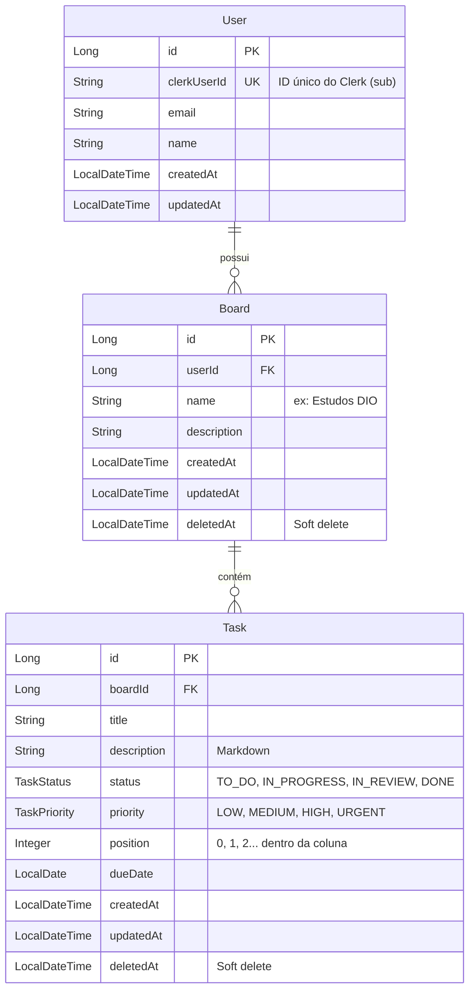

# SPEC-001: TaskManager SaaS Kanban API

## 1. Visão Geral e Objetivo do Produto
O **TaskManager** é uma API REST desenvolvida em **Spring Boot (Java 21)** voltada para servir como backend de um produto SaaS de gerenciamento de tarefas pessoal e acadêmico/profissional (ex: estudos DIO e rotina diária), estruturado em torno da metodologia **Kanban**.

---

## 2. Decisões Arquiteturais e Tecnologias

| Área | Decisão | Detalhe |
|---|---|---|
| **Linguagem & Framework** | Java 21 LTS + Spring Boot 3.4.1 | Clean Architecture (Domain, Application, Infrastructure). |
| **Autenticação** | Clerk com OTP + Dev Mock | Em prod: JWT validado via JWKS. Em `dev`: header opcional `X-Mock-User` para testes no Swagger/Postman. (Ver ADR-0001) |
| **Sincronização de Usuários** | JIT Sync + Onboarding | Na primeira requisição, cria o `User` local e um quadro inicial `"Meu Primeiro Quadro"` com 3 tarefas de boas-vindas. |
| **Banco de Dados** | H2 em arquivo local (`jdbc:h2:file:./data/taskdb`) | Dados persistem entre reinicializações sem dependência de Docker. |
| **Reordenação Kanban** | Reordenação Densa (Shift) | Posições inteiras contíguas (`0, 1, 2...`). Atualizações com shift em lote transacional. (Ver ADR-0002) |
| **Estrutura de Exclusão** | Soft Delete | Registros contêm `deleted_at` para histórico e auditoria. |
| **Documentação da API** | SpringDoc OpenAPI (Swagger UI) | Rotas `/swagger-ui/**`, `/api-docs/**` e `/h2-console/**` públicas em desenvolvimento. |

---

## 3. Modelo de Domínio (Linguagem Ubíqua)

Consulte o [GLOSSARY.md](GLOSSARY.md) para definições detalhadas de cada termo.

---

## 4. Endpoints e Contratos de API

### 4.1. Quadros (Boards)
- `GET /api/boards` - Lista todos os quadros ativos do usuário autenticado.
- `GET /api/boards/{id}` - Obtém o quadro com suas tarefas ativas agrupadas pelas 4 colunas de status.
- `POST /api/boards` - Cria um novo quadro.
- `PUT /api/boards/{id}` - Atualiza metadados do quadro (nome, descrição).
- `DELETE /api/boards/{id}` - Soft delete do quadro e de suas tarefas associadas.

### 4.2. Tarefas (Tasks)
- `GET /api/boards/{boardId}/tasks` - Lista tarefas de um quadro com filtros opcionais (`?status=IN_PROGRESS&priority=HIGH`).
- `GET /api/boards/{boardId}/tasks/{taskId}` - Detalhes da tarefa.
- `POST /api/boards/{boardId}/tasks` - Cria uma nova tarefa na coluna desejada (inserida automaticamente no final da coluna).
- `PUT /api/boards/{boardId}/tasks/{taskId}` - Atualiza título, descrição, prioridade, data de vencimento.
- `PATCH /api/boards/{boardId}/tasks/{taskId}/move` - Movimenta a tarefa entre colunas e ajusta posições vizinhas.
  - Payload: `{ "newStatus": "IN_PROGRESS", "newPosition": 0 }`
- `DELETE /api/boards/{boardId}/tasks/{taskId}` - Soft delete da tarefa e recálculo das posições subsequentes na coluna.

---

## 5. Próximos Passos (Skills Sequence)
1. **`to-tickets`**: Transformar esta especificação revisada em uma lista de tickets atômicos e sequenciais.
2. **`tdd`**: Executar o ciclo Red-Green-Refactor para cada ticket.
3. **`code-review`**: Validar o código implementado contra este SPEC e os padrões do projeto.
